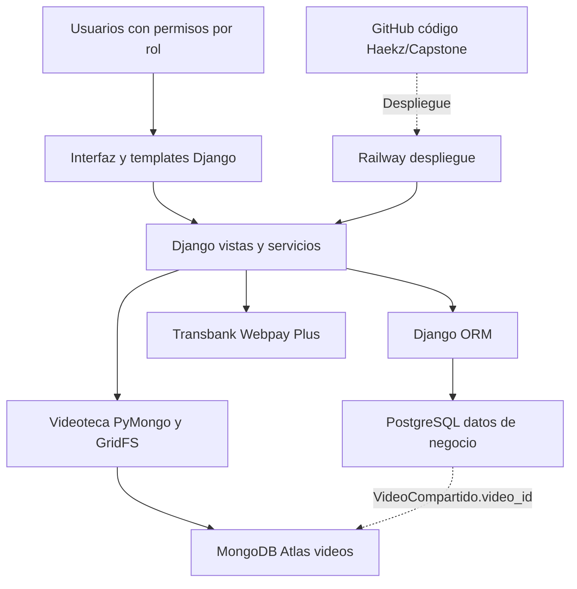

# Capstone - Grupo 5

Repositorio académico de **LBWUS — Learn Better With Us**, desarrollado como Proyecto APT de Ingeniería en Informática en Duoc UC por el Grupo 5. Reúne la documentación, la planificación Scrum y las evidencias incorporadas durante las fases de Capstone, conservando el historial de sus modificaciones.

El código de la aplicación se mantiene en **[Haekz/Capstone](https://github.com/Haekz/Capstone)**. Las instrucciones de instalación y ejecución de este README corresponden a ese repositorio.

**Actualización documental:** 16 de noviembre de 2026. Descripción técnica contrastada con `main` de la aplicación en el commit [`a96b0f2f30e9`](https://github.com/Haekz/Capstone/commit/a96b0f2f30e9cb10a0ebbde66b01ef52747ca0ec).

# LBWUS — Learn Better With Us

Plataforma web de reforzamiento académico en múltiples asignaturas que facilita el encuentro entre estudiantes y profesores y reúne la contratación, coordinación y seguimiento de las tutorías.

## ¿Qué es LBWUS?

LBWUS busca facilitar el acceso a apoyo académico para distintas necesidades de aprendizaje, centralizando la búsqueda de profesores, la consulta de sus antecedentes, la disponibilidad y la reserva de clases. La plataforma incorpora paquetes de tutorías, mensajería, videos de apoyo, notificaciones y seguimiento de la actividad académica.

Para los profesores, ofrece un espacio para presentar sus especialidades y desarrollar su reputación mediante reseñas verificadas de estudiantes que han realizado clases. También contempla flujos de apoderados y estudiantes menores de edad, junto con herramientas de soporte y administración.

El proyecto utiliza **Git y GitHub para el control de versiones**, diferenciando este repositorio documental del repositorio de código. Jira permite seguir el Product Backlog y los Sprints; las evidencias de QA y de integración continua respaldan los resultados de las pruebas.

### Organización de este repositorio

| Carpeta | Propósito |
| --- | --- |
| [Fase 1](Fase%201/) | Definición del proyecto, alcance, planificación y evidencias iniciales del equipo. |
| [Fase 2](Fase%202/) | Entregables de desarrollo, seguimiento, documentación técnica, pruebas y retrospectivas incorporadas. |
| [Fase 3](Fase%203/) | Carpeta destinada a los entregables de cierre y las evidencias finales de Capstone. |

## Funcionalidades

La versión de código revisada incorpora los siguientes módulos y flujos:

- **Cuentas y acceso por rol:** registro, autenticación, recuperación de cuentas y portales de alumnos, profesores, apoderados, soporte y administración.
- **Perfiles y oferta académica:** asignaturas, especialidades y antecedentes de los profesores, con revisión de documentos para su habilitación.
- **Planes y pagos:** paquetes de clases e integración con Transbank Webpay Plus, con registro de órdenes, estados y confirmaciones de pago.
- **Agenda y reservas:** disponibilidad semanal del profesor, generación de sesiones, consulta de cupos, reservas, cancelaciones y reprogramaciones según las reglas del servicio.
- **Clases y seguimiento:** acceso autorizado a salas virtuales, gestión de sesiones y observaciones del profesor.
- **Mensajería y notificaciones:** conversaciones entre participantes autorizados, avisos en la plataforma y correos asociados a los flujos del sistema.
- **Reseñas verificadas:** calificaciones vinculadas a clases realizadas y herramientas para reportar y moderar reseñas.
- **Apoderados y menores:** revisión de identidad y vínculos, compras y gestión de clases por el apoderado, con permisos diferenciados.
- **Videoteca:** carga de videos de apoyo por el profesor, almacenamiento mediante MongoDB/GridFS y entrega vinculada a paquetes.
- **Soporte:** tickets, respuestas, asignación, escalamiento y revisión de solicitudes y reportes.
- **Administración y finanzas:** gestión de usuarios y asignaturas, métricas, revisión de retiros y registro de su resolución.
- **Privacidad y operación:** solicitudes de eliminación de cuenta y tareas diarias de mantenimiento.

Esta lista describe capacidades implementadas en el código. La habilitación de servicios externos y de usuarios reales debe contrastarse con la configuración y las validaciones operativas documentadas en [Estado actual y evolución](#estado-actual-y-evolución).

## Innovación y propuesta de valor

### Problema que aborda

Los estudiantes pueden encontrar dificultades para localizar, comparar y contactar a profesores o profesionales que ofrezcan apoyo académico. La información suele estar distribuida entre canales independientes, lo que dificulta evaluar las alternativas de acuerdo con especialidad, modalidad, disponibilidad y otros antecedentes relevantes.

### Propuesta de LBWUS

LBWUS propone concentrar en una plataforma web la oferta de apoyo académico de profesores e ingenieros, facilitando el encuentro entre quienes necesitan reforzar conocimientos y quienes pueden impartir tutorías.

El valor diferenciador propuesto se basa en la combinación de:

- **Búsqueda y comparación en un mismo entorno:** acceso a perfiles profesionales y criterios de consulta relevantes para el estudiante.
- **Confianza y control:** gestión de perfiles, acceso según roles y consideración de antecedentes o títulos profesionales en el proceso de habilitación.
- **Continuidad del servicio:** disponibilidad, reservas, paquetes, pagos, mensajería, notificaciones y reseñas articulados en el recorrido de las tutorías.
- **Oportunidades para profesionales:** un canal digital para presentar especialidades, ofrecer apoyo académico y fortalecer su reputación a partir de reseñas verificadas.

La propuesta de valor se concreta en los módulos descritos en este README. Los pendientes de validación, configuración productiva y mejora se registran por separado para conservar la trazabilidad del estado del producto.

### Valor que aporta

**Para estudiantes:** facilitar la identificación y comparación de alternativas de apoyo académico en múltiples asignaturas, organizar sus clases y atender distintas necesidades de reforzamiento.

**Para profesores e ingenieros:** ofrecer mayor visibilidad de sus conocimientos, experiencia y servicios de tutoría, con antecedentes y reseñas que ayuden a los estudiantes a evaluar sus alternativas.

**Para el proyecto:** construir una solución modular que pueda incorporar nuevas funcionalidades y validarlas gradualmente, de acuerdo con las necesidades de sus usuarios.

## Tecnologías utilizadas

| Componente | Tecnología | Uso en LBWUS |
| --- | --- | --- |
| Lenguaje principal | Python 3.13 | Versión utilizada en el flujo de integración continua. |
| Framework web | Django 5.2.18 | Vistas, plantillas, autenticación, modelos y reglas de negocio. |
| Frontend | HTML, CSS y JavaScript | Interfaz web responsiva y templates de Django. |
| Base de datos principal | PostgreSQL | Datos relacionales y transaccionales; PostgreSQL 16 en CI. |
| Archivos de video | MongoDB Atlas y GridFS mediante PyMongo | Contenido binario y metadatos de los videos de apoyo. |
| Pruebas | Runner de Django, pytest y mongomock | Pruebas automatizadas, herramientas de QA y simulación de MongoDB. |
| Integración continua | GitHub Actions | Comprobación de Django y ejecución de la suite en cambios y pull requests. |
| Servidor WSGI | Gunicorn 26.2.0 | Ejecución de Django en el despliegue. |
| Archivos estáticos | WhiteNoise 6.12.0 | Entrega de archivos estáticos. |
| Infraestructura | Railway | Despliegue de la aplicación y servicios asociados. |
| Repositorio y control de versiones | Git y GitHub | Historial, colaboración y trazabilidad del código y la documentación. |
| Gestión del trabajo | Jira | Product Backlog, Sprints y seguimiento de los avances. |
| Pagos | Transbank Webpay Plus | Flujo de integración y configuración diferenciada para producción. |

Las versiones de las dependencias de producción se fijan en [requirements.txt](https://github.com/Haekz/Capstone/blob/main/requirements.txt). Las herramientas de desarrollo y QA se encuentran en [requirements-dev.txt](https://github.com/Haekz/Capstone/blob/main/requirements-dev.txt). La versión de Python de CI se define en [tests.yml](https://github.com/Haekz/Capstone/blob/main/.github/workflows/tests.yml).

**Entorno local:** se utiliza un entorno virtual de Python y una base PostgreSQL. El código revisado no incluye archivos propios `Dockerfile` ni `docker-compose`; su instalación local no requiere Docker. GitHub Actions utiliza un servicio PostgreSQL 16 para las pruebas.

### Criterio de ejecución y ausencia de contenedores Docker

La arquitectura de LBWUS adopta un modelo de ejecución directa que no requiere la utilización de Docker ni en desarrollo ni en producción:

1. **Gestión de infraestructura en Railway:** el despliegue productivo utiliza el soporte nativo de la plataforma para entornos Python, instalando las dependencias declaradas en `requirements.txt` y ejecutando Gunicorn sin requerir manifiestos `Dockerfile` ni `docker-compose` propios [2, 4].

2. **Entrega de estáticos integrada:** el uso de WhiteNoise como middleware de Django permite resolver el almacenamiento y entrega de archivos estáticos con compresión directamente desde el servidor web de la aplicación, suprimiendo la necesidad de empaquetar un contenedor proxy inverso auxiliar.

3. **Persistencia como servicio administrado:** tanto PostgreSQL (datos relacionales y transaccionales) como MongoDB Atlas (videoteca y GridFS) se consumen de forma desacoplada como servicios en la nube a través de variables de entorno, evitando alojar y gestionar motores de datos dentro de contenedores en el servidor de aplicación.

4. **Simplicidad en desarrollo local y CI:** el entorno local opera mediante un entorno virtual convencional `.venv`, y el flujo de integración continua en GitHub Actions ejecuta las comprobaciones y pruebas automatizadas sobre servicios directos de PostgreSQL 16, garantizando un ciclo de ejecución rápido y libre de capas de abstracción innecesarias.

## Arquitectura del sistema

### Visión general

LBWUS utiliza una arquitectura web basada en Django y el patrón **Modelo–Vista–Template (MVT)**. El navegador presenta las interfaces; las vistas y servicios aplican las reglas de negocio y los permisos; el ORM gestiona la persistencia relacional.

El almacenamiento distingue dos responsabilidades:

- **PostgreSQL:** cuentas y perfiles, apoderados y vínculos, clases y sesiones, disponibilidad, paquetes, pagos, inscripciones, retiros, mensajes, notificaciones, reseñas y soporte.
- **MongoDB Atlas con GridFS:** archivos de video y metadatos de autor, asignatura, título y duración. La videoteca utiliza el bucket `videos`, con las colecciones `videos.files` y `videos.chunks`.

Los mensajes, las notificaciones y las reseñas cuentan con modelos Django en la base relacional.

El repositorio [Haekz/Capstone](https://github.com/Haekz/Capstone) contiene la aplicación y su flujo de CI. Railway ejecuta el despliegue; este repositorio conserva los entregables académicos y su historial.

### Diagrama de arquitectura



**Lectura del diagrama:** las líneas continuas representan la relación entre los componentes de la aplicación. Las líneas discontinuas identifican la referencia lógica del registro relacional al archivo de GridFS y la relación de despliegue. El diagrama resume la arquitectura implementada; la configuración efectiva de cada servicio se verifica en su entorno.

### Componentes y responsabilidades

| Componente | Responsabilidad |
| --- | --- |
| Interfaz web | Presentar formularios, paneles y acciones según el tipo de usuario. |
| Django | Procesar solicitudes, aplicar reglas del servicio y gestionar autenticación y permisos. |
| ORM y PostgreSQL | Persistir las entidades de negocio, sus relaciones y las restricciones de integridad. |
| Videoteca y GridFS | Validar, almacenar y recuperar videos de apoyo y sus metadatos. |
| GitHub Actions | Ejecutar la comprobación de Django y las pruebas con PostgreSQL en un entorno de CI. |
| Railway | Ejecutar la aplicación; los procesos diarios requieren configurar su servicio programado. |
| Git y GitHub | Controlar las versiones del código y los entregables documentales en sus repositorios respectivos. |
| Webpay Plus | Gestionar el flujo de pago y su confirmación mediante la integración con Transbank. |

### Modelo de datos e integridad

El modelo relacional se mantiene mediante migraciones de Django. Sus entidades incluyen:

| Área | Entidades representativas |
| --- | --- |
| Identidad y perfiles | `CustomUser`, `Alumno`, `Profesor`, `Apoderado` y `Vinculo`. |
| Oferta y agenda | `Clase`, `SesionClase`, `HorarioSemanal` y `BloqueAgenda`. |
| Contratación y reservas | `PaqueteClases`, `Suscripcion` e `Inscripcion`. |
| Interacciones y soporte | `Conversacion`, `Mensaje`, `Notificacion`, `Resena` y `Ticket`. |
| Videos y pagos relacionados | `VideoCompartido`, `CompraVideosExtra`, `DevolucionVideos` y `ReembolsoTransbank`. |

Las reservas relacionan al alumno con una sesión y con el paquete utilizado. Los modelos de pago registran la orden, el monto, el estado y, cuando corresponde, la autorización y la fecha de confirmación.

La integridad combina restricciones del modelo y servicios transaccionales: unicidad de las inscripciones activas, validaciones de fechas, cupos y precios, y uso de `transaction.atomic` y `select_for_update` en reservas y reprogramaciones.

`VideoCompartido.video_id` conserva como texto el identificador del archivo en GridFS. Las referencias entre PostgreSQL y MongoDB se validan desde la aplicación; no constituyen claves foráneas entre motores ni una transacción distribuida.

Fuentes del modelo: [usuarios](https://github.com/Haekz/Capstone/blob/main/alumnos/models/usuarios.py), [clases e inscripciones](https://github.com/Haekz/Capstone/blob/main/alumnos/models/clases.py), [paquetes y pagos](https://github.com/Haekz/Capstone/blob/main/alumnos/models/pagos.py), [videos compartidos](https://github.com/Haekz/Capstone/blob/main/alumnos/models/videos.py), [agenda](https://github.com/Haekz/Capstone/blob/main/agenda/models.py) y [videoteca](https://github.com/Haekz/Capstone/blob/main/user_profesor/videoteca.py).

### Estado actual y evolución

Las reservas con estado, los paquetes y el registro de pagos forman parte del código revisado, junto con la mensajería, las reseñas, las notificaciones, los apoderados, el soporte y la videoteca. El Product Backlog y [PENDIENTES_LBWUS.md](https://github.com/Haekz/Capstone/blob/main/docs/PENDIENTES_LBWUS.md) mantienen el detalle del trabajo y las validaciones que continúan pendientes.

La operación se verifica separadamente de la implementación:

- **Webpay:** la configuración distingue los ambientes de integración y producción. Los cobros reales requieren habilitar y validar los parámetros productivos.
- **MongoDB Atlas:** las pruebas ordinarias utilizan mongomock. La conexión y las pruebas contra Atlas real requieren configuración específica y se identifican como integración.
- **Menores y apoderados:** los flujos implementados deben habilitarse conforme a las decisiones y revisiones documentadas por el proyecto.
- **Procesos diarios:** el comando `python manage.py tareas_diarias` reúne ocho tareas, comenzando por la generación de bloques de agenda. Su ejecución automática requiere configurar y verificar el Cron de Railway.

La configuración operativa se documenta en [CONFIGURACION_PRODUCCION.md](https://github.com/Haekz/Capstone/blob/main/docs/CONFIGURACION_PRODUCCION.md); las reglas del servicio, en [POLITICA_PAQUETES.md](https://github.com/Haekz/Capstone/blob/main/docs/POLITICA_PAQUETES.md) y [DECISIONES_SOPORTE_Y_PAGOS.md](https://github.com/Haekz/Capstone/blob/main/docs/DECISIONES_SOPORTE_Y_PAGOS.md).

## Instalación local

### Prerrequisitos

- Python 3.13, `pip` y Git.
- PostgreSQL en un entorno de desarrollo.
- Variables de entorno y configuración de los servicios que se utilizarán.

La instalación se realiza desde el repositorio de código de la aplicación.

### Procedimiento de referencia

1. Clonar el código y entrar en su directorio:

```bash
git clone https://github.com/Haekz/Capstone.git
cd Capstone
python -m venv .venv
```

2. Activar el entorno virtual:

```bash
# Linux o macOS
source .venv/bin/activate
```

```powershell
# Windows PowerShell
.\.venv\Scripts\Activate.ps1
```

3. Instalar las dependencias de desarrollo y QA, que incluyen las de la aplicación:

```bash
pip install -r requirements-dev.txt
```

4. Configurar `DATABASE_URL` con una base PostgreSQL local y las variables necesarias para el entorno, siguiendo la [documentación de configuración](https://github.com/Haekz/Capstone/blob/main/docs/CONFIGURACION_PRODUCCION.md). Para utilizar los videos se requiere configurar MongoDB; las claves y credenciales se mantienen fuera del repositorio.

5. Aplicar las migraciones y levantar el servidor de desarrollo:

```bash
python manage.py migrate
python manage.py runserver
```

En Railway se instalan las dependencias de producción de `requirements.txt`. El servidor de desarrollo y las herramientas de QA corresponden al entorno local.

## Pruebas

La suite puede ejecutarse con el **runner de Django** o con **pytest**, según [PRUEBAS.md](https://github.com/Haekz/Capstone/blob/main/docs/PRUEBAS.md). Ambas opciones utilizan los ajustes de pruebas del proyecto.

Antes de ejecutarla:

- Instalar `requirements-dev.txt` y configurar `DATABASE_URL` con PostgreSQL de desarrollo o pruebas. Django crea y elimina su base de pruebas en ese servidor; no se utiliza la conexión productiva.
- Mantener la suite ordinaria sin una URI real de Atlas y sin la puerta `SITIO_CLAVE`, según las instrucciones de pruebas.
- Utilizar mongomock para los casos ordinarios de MongoDB. Las pruebas de integración con Atlas se habilitan de forma explícita y separada.

Comandos desde la raíz de la aplicación:

```bash
python manage.py check
python manage.py test --noinput
```

Como alternativa de ejecución local:

```bash
pytest
```

El flujo de [GitHub Actions](https://github.com/Haekz/Capstone/blob/main/.github/workflows/tests.yml) se activa en `push` y `pull_request`, utiliza Python 3.13 y un servicio PostgreSQL 16, instala `requirements-dev.txt` y ejecuta la comprobación de Django y `python manage.py test --noinput`.

Las pruebas automatizadas se complementan con los casos manuales de QA y las evidencias del proyecto. Sus resultados deben identificarse con la versión y el entorno en que se obtuvieron.

## Metodología de trabajo

LBWUS utiliza **Scrum** como marco de trabajo ágil para desarrollar el producto de manera iterativa e incremental, permitiendo organizar las actividades, realizar entregas progresivas y adaptar las prioridades de acuerdo con los resultados obtenidos.

El proyecto se estructura mediante los siguientes elementos:

- **Product Backlog:** conjunto priorizado de requisitos, historias de usuario, funcionalidades y mejoras pendientes del producto.
- **Sprint Backlog:** selección de elementos del Product Backlog que el equipo se compromete a desarrollar durante cada Sprint, junto con el plan necesario para alcanzar su objetivo.
- **Sprints:** iteraciones de dos semanas, equivalentes a 10 días hábiles, orientadas a desarrollar y validar incrementos del producto.
- **Sprint Planning:** planificación del objetivo y trabajo de cada Sprint, considerando las prioridades del producto y la capacidad del equipo.
- **Daily Scrum:** instancia breve de inspección del progreso hacia el objetivo del Sprint y adaptación del plan de trabajo.
- **Sprint Review:** revisión de los resultados y del incremento desarrollado, permitiendo obtener retroalimentación y ajustar las prioridades.
- **Sprint Retrospective:** instancia para identificar oportunidades de mejora en la colaboración, las prácticas técnicas y la organización del equipo.

Para la gestión y seguimiento del proyecto se utiliza **Jira**, herramienta que permite administrar el Product Backlog, organizar los Sprints, visualizar los estados de las actividades y mantener la trazabilidad de los avances.

Complementariamente, se utiliza **Git y GitHub** para administrar el repositorio del proyecto, gestionar las versiones del código y la documentación, facilitar el trabajo colaborativo y mantener un historial de los cambios realizados durante el desarrollo.

La aplicación de Scrum permite mantener un enfoque colaborativo, priorizar funcionalidades de acuerdo con el valor que aportan y realizar ajustes durante el desarrollo sin depender de una planificación rígida de todas las actividades desde el inicio.

## Roles y responsabilidades del equipo

El equipo de LBWUS se organiza de acuerdo con las responsabilidades establecidas en Scrum, promoviendo la colaboración y la participación de sus integrantes durante el desarrollo del proyecto.

| Integrante | Rol Scrum | Responsabilidades principales |
| --- | --- | --- |
| **Francheska Cisterna Porras** | **Scrum Master** | Facilitar la aplicación de Scrum, coordinar el seguimiento del trabajo, apoyar la resolución de impedimentos, promover la colaboración del equipo y mantener la trazabilidad de avances y evidencias. |
| **Benjamín Nicovani Moya** | **Product Owner** | Gestionar y priorizar el Product Backlog, clarificar los requisitos, definir criterios de aceptación y orientar el desarrollo hacia las necesidades de los usuarios y los objetivos del producto. |
| **Franco Sáez Martínez** | **Developer** | Participar en el desarrollo técnico de la plataforma, la implementación de funcionalidades, el backend, la persistencia de datos, las integraciones y las pruebas del sistema. |

### Trabajo colaborativo

Si bien cada integrante desempeña responsabilidades específicas dentro de Scrum, el desarrollo de LBWUS se realiza mediante un enfoque colaborativo.

Los integrantes participan transversalmente en actividades de análisis de requisitos, diseño, desarrollo frontend y backend, gestión de datos, pruebas, documentación técnica y validación de funcionalidades, según las necesidades y prioridades de cada Sprint.

Los roles de Scrum no representan una división exclusiva de las actividades técnicas, sino responsabilidades complementarias que permiten mejorar la coordinación, organización y entrega de valor del proyecto.
