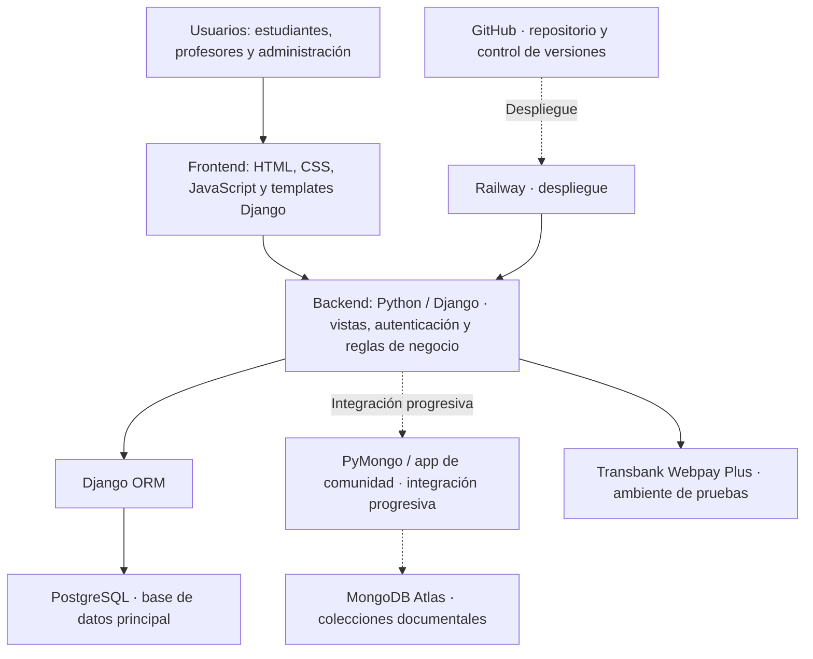

# Capstone - Grupo 5

Repositorio del proyecto LBWUS alojado en GitHub, utilizado para gestionar los archivos del proyecto, mantener el historial de cambios y administrar el control de versiones durante su desarrollo.

# LBWUS — Learn Better With Us

Una plataforma de autoaprendizaje colaborativo donde profesores y estudiantes se encuentran para enseñar, aprender y crecer juntos.

## ¿Qué es LBWUS?

LBWUS es una aplicación web de autoaprendizaje desarrollada como proyecto universitario. Está pensada para construir una comunidad educativa inclusiva donde tanto profesores como estudiantes pueden unirse para compartir conocimiento, acceder a clases y ser parte de una comunidad que cree en el aprendizaje continuo.

El proyecto utiliza **GitHub como repositorio para la gestión del código, la documentación y el control de versiones**, permitiendo registrar los cambios realizados, mantener la trazabilidad del desarrollo y facilitar el trabajo colaborativo de los integrantes del equipo.

## Funcionalidades

- Registro e inicio de sesión para alumnos y profesores.
- Portal de administración para gestión de usuarios.
- Registro y gestión de alumnos.
- Sistema de autenticación con roles diferenciados.
- Interfaz web responsiva.

## Innovación y propuesta de valor

### Problema que aborda

Los estudiantes pueden encontrar dificultades para localizar, comparar y contactar a profesores o profesionales que ofrezcan apoyo académico. La información suele estar distribuida entre canales independientes, lo que dificulta evaluar las alternativas de acuerdo con especialidad, modalidad, disponibilidad y otros antecedentes relevantes.

### Propuesta de LBWUS

LBWUS propone concentrar en una plataforma web la oferta de apoyo académico de profesores e ingenieros, facilitando el encuentro entre quienes necesitan reforzar conocimientos y quienes pueden impartir tutorías.

El valor diferenciador propuesto se basa en la combinación de:

- **Búsqueda y comparación en un mismo entorno:** acceso a perfiles profesionales y criterios de consulta relevantes para el estudiante.
- **Confianza y control:** gestión de perfiles, acceso según roles y consideración de antecedentes o títulos profesionales en el proceso de habilitación.
- **Continuidad del servicio:** evolución hacia disponibilidad, reservas, pagos, mensajería, notificaciones y reseñas, integrados en un mismo recorrido.
- **Oportunidades para profesionales:** un canal digital para presentar especialidades y ofrecer apoyo académico.

Estas capacidades se desarrollan progresivamente. La descripción de la propuesta de valor no significa que todas las funcionalidades estén terminadas o disponibles en producción.

### Valor que aporta

**Para estudiantes:** facilitar la identificación y comparación de alternativas de apoyo académico y reducir la dependencia de búsquedas dispersas.

**Para profesores e ingenieros:** ofrecer mayor visibilidad de sus conocimientos, experiencia y servicios de tutoría.

**Para el proyecto:** construir una solución modular que pueda incorporar nuevas funcionalidades y validarlas gradualmente, de acuerdo con las necesidades de sus usuarios.

## Tecnologías utilizadas

| Componente | Tecnología | Uso en LBWUS |
| --- | --- | --- |
| Lenguaje principal | Python 3.13 | Desarrollo del backend. |
| Framework web | Django 5.0.6 | Vistas, plantillas, autenticación y lógica de la aplicación. |
| Frontend | HTML, CSS y JavaScript | Interfaz de usuario y presentación de contenido. |
| Base de datos principal | PostgreSQL | Persistencia de datos relacionales y transaccionales. |
| Datos documentales previstos | MongoDB Atlas | Interacciones y contenido social del producto; adopción funcional progresiva. |
| Servidor WSGI | Gunicorn | Ejecución de Django en el despliegue. |
| Archivos estáticos | WhiteNoise | Entrega de archivos estáticos. |
| Infraestructura | Railway | Despliegue de la plataforma web. |
| Repositorio y control de versiones | Git y GitHub | Almacenamiento y gestión del proyecto, colaboración, historial y trazabilidad de cambios. |
| Pagos | Transbank / Webpay Plus | Integración documentada en ambiente de pruebas. |

**Nota sobre las versiones:** las versiones de Python y Django deben verificarse en el entorno de desarrollo y en `requirements.txt` antes de considerarse definitivas.

## Arquitectura del sistema

### Visión general

LBWUS utiliza una arquitectura web basada en Django, siguiendo el patrón **Modelo–Vista–Template (MVT)**. El navegador presenta las interfaces desarrolladas con HTML, CSS y JavaScript; Django procesa las solicitudes, aplica las reglas de negocio y accede a los datos mediante sus componentes de persistencia.

El modelo de datos documentado distingue dos responsabilidades:

- **PostgreSQL:** almacenamiento relacional y transaccional principal, incluyendo cuentas de usuario, perfiles, clases, inscripciones, reportes y solicitudes de retiro.
- **MongoDB Atlas:** almacenamiento documental previsto para actividad, notificaciones, reseñas, conversaciones y mensajes. El esquema de estas cinco colecciones está documentado; su uso funcional se incorpora de manera progresiva.

El proyecto utiliza **GitHub como repositorio de control de versiones**, donde se registra el historial de modificaciones y se facilita la colaboración entre los integrantes del equipo. La aplicación se despliega mediante Railway.

### Diagrama de arquitectura



**Lectura del diagrama:** las líneas continuas representan las conexiones descritas como parte de la arquitectura de la aplicación; las líneas discontinuas identifican componentes cuya integración funcional es progresiva o relaciones de despliegue. GitHub se utiliza para gestionar el repositorio y el historial de cambios, mientras que Railway ejecuta la aplicación desplegada.

### Componentes y responsabilidades

| Componente | Responsabilidad |
| --- | --- |
| Interfaz web | Presentar páginas, formularios y vistas para los distintos tipos de usuario. |
| Django | Resolver solicitudes, aplicar reglas del negocio y gestionar permisos y autenticación. |
| ORM de Django | Gestionar el acceso a los modelos relacionales. |
| PostgreSQL | Persistir la información estructurada y transaccional del sistema. |
| MongoDB Atlas | Recibir datos documentales de interacción cuando los módulos respectivos estén integrados. |
| Railway | Alojar y ejecutar la aplicación desplegada. |
| Git y GitHub | Gestionar el repositorio del proyecto, controlar versiones, mantener el historial de modificaciones y facilitar el desarrollo colaborativo. |
| Transbank | Procesar el flujo de pagos en el ambiente de integración documentado. |

### Modelo de datos e integridad

La documentación técnica del modelo relacional describe **12 tablas y 13 claves foráneas**, organizadas alrededor del usuario central (`CustomUser`) y los perfiles de alumno, profesor y administrador. El sistema utiliza una entidad de inscripción para vincular alumnos con clases.

Los identificadores compartidos entre PostgreSQL y MongoDB no cuentan con claves foráneas físicas entre ambas tecnologías; por ello, cualquier integración documental deberá validar la existencia y autorización de los registros relacionados desde la aplicación.

### Estado actual y evolución

De acuerdo con la documentación técnica disponible, el modelo relacional está definido, mientras que las cinco colecciones de MongoDB se encuentran creadas pero sin datos operativos. Asimismo, el esquema relacional examinado aún no incorpora una tabla transaccional de pagos. La disponibilidad horaria, las reservas con estado y otras capacidades del servicio se consideran oportunidades de evolución del modelo.

Esta distinción evita presentar funcionalidades proyectadas como si ya estuvieran finalizadas.

## Instalación local

### Prerrequisitos

- Python 3.13+
- `pip`
- Git
- PostgreSQL
- Acceso a las variables de entorno requeridas por el proyecto.

### Procedimiento de referencia

La instalación debe ejecutarse desde el directorio que contiene el código Django de la aplicación, utilizando la versión correspondiente del proyecto gestionada mediante GitHub.

1. Clonar el repositorio de código desde GitHub y seleccionar la rama de trabajo correspondiente.
2. Crear y activar un entorno virtual de Python.
3. Instalar las dependencias definidas en `requirements.txt`.
4. Configurar las variables de entorno necesarias, incluyendo la conexión a PostgreSQL, sin incorporar credenciales ni secretos al repositorio.
5. Ejecutar las migraciones y levantar el servidor de desarrollo.

Comandos de referencia, ejecutados desde la raíz del proyecto Django y después de activar el entorno virtual:

```bash
pip install -r requirements.txt
python manage.py migrate
python manage.py runserver
```

La configuración específica de PostgreSQL, MongoDB, servicios externos y demás variables de entorno debe seguir la documentación técnica y las instrucciones vigentes del repositorio de código.

## Metodología de trabajo

LBWUS utiliza **Scrum** como marco de trabajo ágil para desarrollar el producto de manera iterativa e incremental, permitiendo organizar las actividades, realizar entregas progresivas y adaptar las prioridades de acuerdo con los resultados obtenidos.

El proyecto se estructura mediante los siguientes elementos:

- **Product Backlog:** conjunto priorizado de requisitos, historias de usuario, funcionalidades y mejoras pendientes del producto.
- **Sprint Backlog:** selección de elementos del Product Backlog que el equipo se compromete a desarrollar durante cada Sprint, junto con el plan necesario para alcanzar su objetivo.
- **Sprints:** iteraciones de dos semanas, equivalentes a 10 días hábiles, orientadas a desarrollar y validar incrementos del producto.
- **Sprint Planning:** planificación del objetivo y trabajo de cada Sprint, considerando las prioridades del producto y la capacidad del equipo.
- **Daily Scrum:** instancia breve de inspección del progreso hacia el objetivo del Sprint y adaptación del plan de trabajo.
- **Sprint Review:** revisión de los resultados y del incremento desarrollado, permitiendo obtener retroalimentación y ajustar las prioridades.
- **Sprint Retrospective:** instancia para identificar oportunidades de mejora en la colaboración, las prácticas técnicas y la organización del equipo.

Para la gestión y seguimiento del proyecto se utiliza **Jira**, herramienta que permite administrar el Product Backlog, organizar los Sprints, visualizar los estados de las actividades y mantener la trazabilidad de los avances.

Complementariamente, se utiliza **Git y GitHub** para administrar el repositorio del proyecto, gestionar las versiones del código y la documentación, facilitar el trabajo colaborativo y mantener un historial de los cambios realizados durante el desarrollo.

La aplicación de Scrum permite mantener un enfoque colaborativo, priorizar funcionalidades de acuerdo con el valor que aportan y realizar ajustes durante el desarrollo sin depender de una planificación rígida de todas las actividades desde el inicio.

## Roles y responsabilidades del equipo

El equipo de LBWUS se organiza de acuerdo con las responsabilidades establecidas en Scrum, promoviendo la colaboración y la participación de sus integrantes durante el desarrollo del proyecto.

| Integrante | Rol Scrum | Responsabilidades principales |
| --- | --- | --- |
| **Francheska Cisterna Porras** | **Scrum Master** | Facilitar la aplicación de Scrum, coordinar el seguimiento del trabajo, apoyar la resolución de impedimentos, promover la colaboración del equipo y mantener la trazabilidad de avances y evidencias. |
| **Benjamín Nicovani Moya** | **Product Owner** | Gestionar y priorizar el Product Backlog, clarificar los requisitos, definir criterios de aceptación y orientar el desarrollo hacia las necesidades de los usuarios y los objetivos del producto. |
| **Franco Sáez Martínez** | **Developer** | Participar en el desarrollo técnico de la plataforma, la implementación de funcionalidades, el backend, la persistencia de datos, las integraciones y las pruebas del sistema. |

### Trabajo colaborativo

Si bien cada integrante desempeña responsabilidades específicas dentro de Scrum, el desarrollo de LBWUS se realiza mediante un enfoque colaborativo.

Los integrantes participan transversalmente en actividades de análisis de requisitos, diseño, desarrollo frontend y backend, gestión de datos, pruebas, documentación técnica y validación de funcionalidades, según las necesidades y prioridades de cada Sprint.

Los roles de Scrum no representan una división exclusiva de las actividades técnicas, sino responsabilidades complementarias que permiten mejorar la coordinación, organización y entrega de valor del proyecto.
