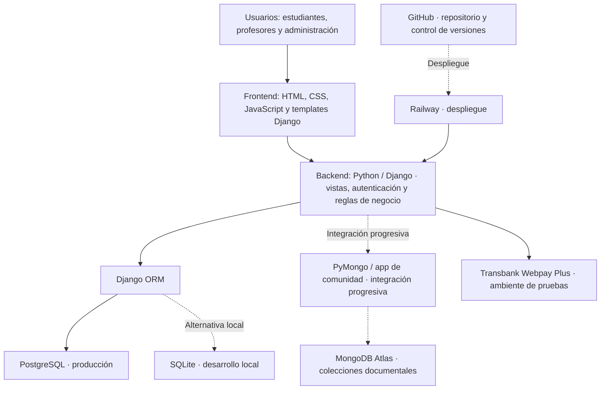

# Capstone - Grupo 5

Repositorio dedicado a la información del proyecto.

# LBWUS — Learn Better With Us

Una plataforma de autoaprendizaje colaborativo donde profesores y estudiantes se encuentran para enseñar, aprender y crecer juntos.

## ¿Qué es LBWUS?

LBWUS es una aplicación web de autoaprendizaje desarrollada como proyecto universitario. Está pensada para construir una comunidad educativa inclusiva donde tanto profesores como estudiantes pueden unirse para compartir conocimiento, acceder a clases y ser parte de una comunidad que cree en el aprendizaje continuo.

## Funcionalidades

- Registro e inicio de sesión para alumnos y profesores.
- Portal de administración para gestión de usuarios.
- Registro y gestión de alumnos.
- Sistema de autenticación con roles diferenciados.
- Interfaz web responsiva.

## Innovación y propuesta de valor

### Problema que aborda

Los estudiantes pueden encontrar dificultades para localizar, comparar y contactar a profesores o profesionales que ofrezcan apoyo académico. La información suele estar distribuida entre canales independientes, lo que dificulta evaluar las alternativas de acuerdo con especialidad, modalidad, disponibilidad y otros antecedentes relevantes.

### Propuesta de LBWUS

LBWUS propone concentrar en una plataforma web la oferta de apoyo académico de profesores e ingenieros, facilitando el encuentro entre quienes necesitan reforzar conocimientos y quienes pueden impartir tutorías.

El valor diferenciador propuesto se basa en la combinación de:

- **Búsqueda y comparación en un mismo entorno:** acceso a perfiles profesionales y criterios de consulta relevantes para el estudiante.
- **Confianza y control:** gestión de perfiles, acceso según roles y consideración de antecedentes o títulos profesionales en el proceso de habilitación.
- **Continuidad del servicio:** evolución hacia disponibilidad, reservas, pagos, mensajería, notificaciones y reseñas, integrados en un mismo recorrido.
- **Oportunidades para profesionales:** un canal digital para presentar especialidades y ofrecer apoyo académico.

Estas capacidades se desarrollan progresivamente. La descripción de la propuesta de valor no significa que todas las funcionalidades estén terminadas o disponibles en producción.

### Valor que aporta

**Para estudiantes:** facilitar la identificación y comparación de alternativas de apoyo académico y reducir la dependencia de búsquedas dispersas.

**Para profesores e ingenieros:** ofrecer mayor visibilidad de sus conocimientos, experiencia y servicios de tutoría.

**Para el proyecto:** construir una solución modular que pueda incorporar nuevas funcionalidades y validarlas gradualmente, de acuerdo con las necesidades de sus usuarios.

## Tecnologías utilizadas

| Componente | Tecnología | Uso en LBWUS |
| --- | --- | --- |
| Lenguaje principal | Python 3.13 | Desarrollo del backend. |
| Framework web | Django 5.0.6 | Vistas, plantillas, autenticación y lógica de la aplicación. |
| Frontend | HTML, CSS y JavaScript | Interfaz de usuario y presentación de contenido. |
| Base de datos de producción | PostgreSQL | Persistencia de datos relacionales y transaccionales. |
| Base de datos local | SQLite | Desarrollo y pruebas locales. |
| Datos documentales previstos | MongoDB Atlas | Interacciones y contenido social del producto; adopción funcional progresiva. |
| Servidor WSGI | Gunicorn | Ejecución de Django en el despliegue. |
| Archivos estáticos | WhiteNoise | Entrega de archivos estáticos. |
| Infraestructura | Railway | Despliegue de la plataforma web. |
| Control de versiones | Git y GitHub | Gestión y trazabilidad de cambios. |
| Pagos | Transbank / Webpay Plus | Integración documentada en ambiente de pruebas. |

**Nota sobre las versiones:** las versiones de Python y Django deben verificarse en el entorno de desarrollo y en `requirements.txt` antes de considerarse definitivas.

## Arquitectura del sistema

### Visión general

LBWUS utiliza una arquitectura web basada en Django, siguiendo el patrón **Modelo–Vista–Template (MVT)**. El navegador presenta las interfaces desarrolladas con HTML, CSS y JavaScript; Django procesa las solicitudes, aplica las reglas de negocio y accede a los datos mediante sus componentes de persistencia.

El modelo de datos documentado distingue dos responsabilidades:

- **PostgreSQL:** almacenamiento relacional y transaccional en producción, incluyendo cuentas de usuario, perfiles, clases, inscripciones, reportes y solicitudes de retiro. En desarrollo local se utiliza SQLite.
- **MongoDB Atlas:** almacenamiento documental previsto para actividad, notificaciones, reseñas, conversaciones y mensajes. El esquema de estas cinco colecciones está documentado; su uso funcional se incorpora de manera progresiva.

### Diagrama de arquitectura



**Lectura del diagrama:** las líneas continuas representan las conexiones descritas como parte de la arquitectura de la aplicación; las líneas discontinuas identifican alternativas de entorno o componentes cuya integración funcional es progresiva. No debe interpretarse que PostgreSQL y SQLite se utilizan simultáneamente en un mismo entorno.

### Componentes y responsabilidades

| Componente | Responsabilidad |
| --- | --- |
| Interfaz web | Presentar páginas, formularios y vistas para los distintos tipos de usuario. |
| Django | Resolver solicitudes, aplicar reglas del negocio y gestionar permisos y autenticación. |
| ORM de Django | Gestionar el acceso a los modelos relacionales. |
| PostgreSQL | Persistir la información estructurada del sistema en producción. |
| SQLite | Permitir la ejecución y el desarrollo local sin depender de la base de producción. |
| MongoDB Atlas | Recibir datos documentales de interacción cuando los módulos respectivos estén integrados. |
| Railway | Alojar y ejecutar la aplicación desplegada. |
| GitHub | Registrar el código, las modificaciones y la colaboración del equipo. |
| Transbank | Procesar el flujo de pagos en el ambiente de integración documentado. |

### Modelo de datos e integridad

La documentación técnica del modelo relacional describe **12 tablas y 13 claves foráneas**, organizadas alrededor del usuario central (`CustomUser`) y los perfiles de alumno, profesor y administrador. El sistema utiliza una entidad de inscripción para vincular alumnos con clases.

Los identificadores compartidos entre PostgreSQL y MongoDB no cuentan con claves foráneas físicas entre ambas tecnologías; por ello, cualquier integración documental deberá validar la existencia y autorización de los registros relacionados desde la aplicación.

### Estado actual y evolución

De acuerdo con la documentación técnica disponible, el modelo relacional está definido, mientras que las cinco colecciones de MongoDB se encuentran creadas pero sin datos operativos. Asimismo, el esquema relacional examinado aún no incorpora una tabla transaccional de pagos. La disponibilidad horaria, las reservas con estado y otras capacidades del servicio se consideran oportunidades de evolución del modelo.

Esta distinción evita presentar funcionalidades proyectadas como si ya estuvieran finalizadas.

## Instalación local

### Prerrequisitos

- Python 3.13+
- `pip`
- Git

### Procedimiento de referencia

La instalación debe ejecutarse desde el repositorio que contiene el código Django de la aplicación. El repositorio de documentación no sustituye al repositorio de código.

1. Clonar el repositorio de código y seleccionar la rama de trabajo correspondiente.
2. Crear y activar un entorno virtual de Python.
3. Instalar las dependencias definidas en `requirements.txt`.
4. Configurar las variables de entorno necesarias sin incluir secretos en GitHub.
5. Ejecutar las migraciones y levantar el servidor de desarrollo.

Comandos de referencia, ejecutados desde la raíz del proyecto Django y después de activar el entorno virtual:

```bash
pip install -r requirements.txt
python manage.py migrate
python manage.py runserver
```

La configuración específica de PostgreSQL, MongoDB, servicios externos y demás variables de entorno debe seguir la documentación técnica y las instrucciones vigentes del repositorio de código.
